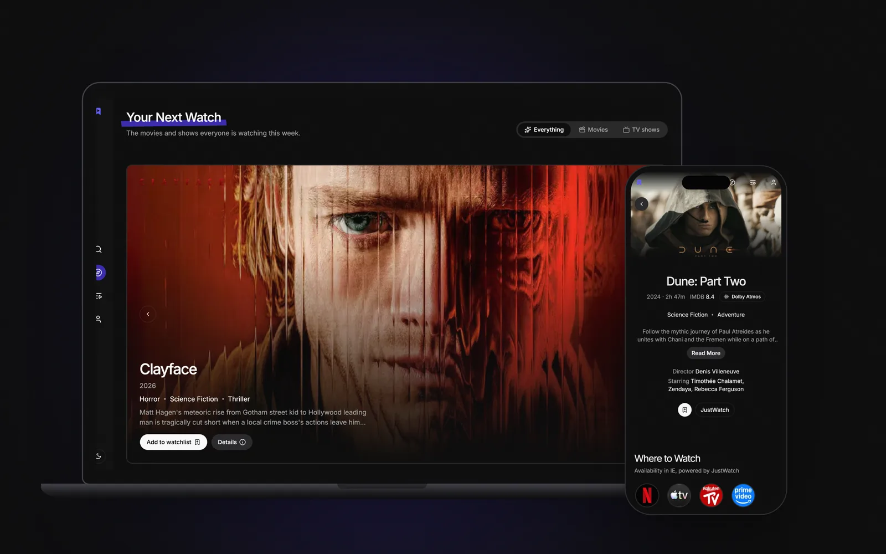
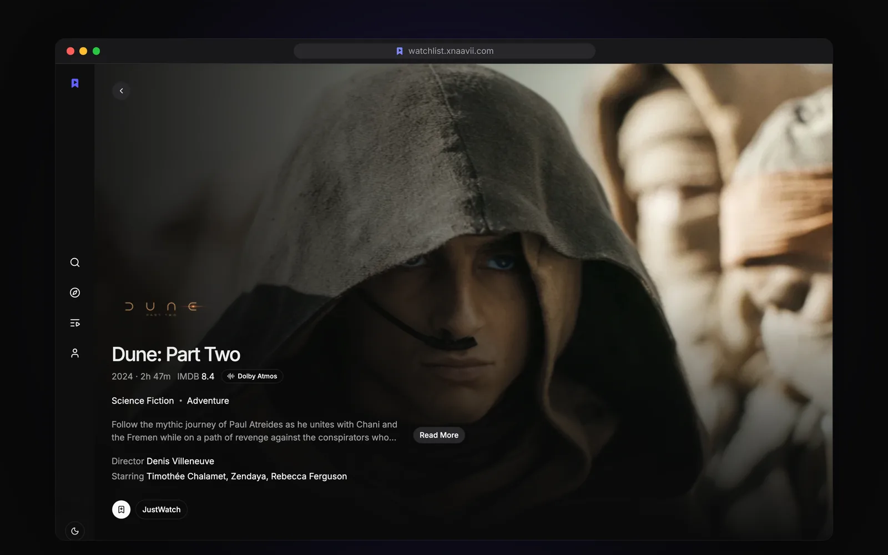
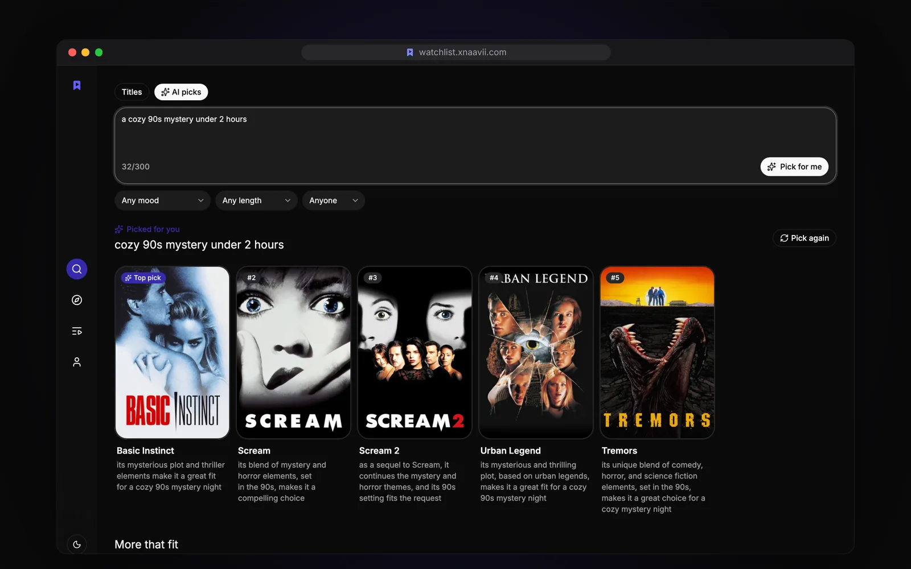
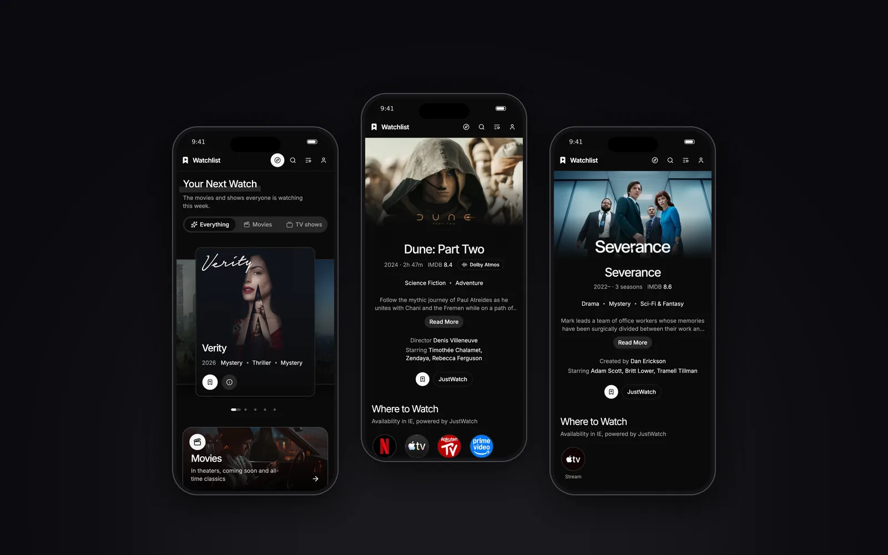

<h1>
  <picture>
    <source media="(prefers-color-scheme: dark)" srcset="docs/brand/logo-dark.svg">
    
  </picture>
</h1>

Find something to watch, fast, and keep track of what you're watching. A discovery and watchlist app for movies and TV shows, built with TanStack Start and deployed on Cloudflare Workers.
Check out the [live site](https://watchlist.xnaavii.com/discover).



## Stack

- **Framework:** TanStack Start + TanStack Router
- **Data fetching:** TanStack Query
- **Database:** Neon (PostgreSQL) + Drizzle ORM
- **Auth:** Better Auth
- **Styling:** Tailwind CSS v4 + shadcn/ui
- **Movie data:** [TMDB API](https://www.themoviedb.org/documentation/api) via `@lorenzopant/tmdb`
- **Ratings:** OMDb API (IMDb ratings)
- **Streaming availability:** Watchmode API
- **AI picks:** Cloudflare Workers AI (Llama 3.3 70B) through the `AI` binding, no API key needed
- **Deployment:** Cloudflare Workers

## Features

- Discover movies and TV shows together, by genre, trend or mood, with filters (genre, year, language, rating, sort)
- Search across titles and people, with debounced infinite scroll
- AI picks: describe a mood ("cozy 90s mystery under 2 hours") in search and get a short list with a reason for each, optionally drawn from your watchlist
- Personal watchlist with watch status (want to watch / watched) and a profile stats dashboard
- Dolby Atmos showcase with community votes and sound ratings
- Sign in with email or Google
- Title details: cast & crew, trailers, gallery, reviews, similar titles, IMDb ratings, streaming availability
- Works without an account: guests keep their list on the device, and signing up syncs it across devices
- Installable PWA that works offline for pages you have opened
- A dark interface built around the posters

## Screenshots

### Title details

Where to stream it, trailer, gallery, cast, reviews and similar titles on one page.



### AI picks

Describe a mood and get a short list with a reason for each pick.



### On your phone



## Getting started

### 1. Install dependencies

This project uses [pnpm](https://pnpm.io). If you don't have it yet, enable it with Corepack (ships with Node), which picks up the version pinned in `package.json`:

```bash
corepack enable
pnpm install
```

### 2. Set up your database

This project uses [Neon Launchpad](https://neon.new) for a zero-config Postgres database. Running the dev server for the first time will prompt you to create one, which automatically populates `DATABASE_URL`.

### 3. Configure environment variables

Copy `.env.example` to `.env` and fill in the values:

```bash
cp .env.example .env
```

| Variable             | How to get it                                                                       |
| -------------------- | ----------------------------------------------------------------------------------- |
| `DATABASE_URL`       | Auto-populated by [Neon Launchpad](https://neon.new)                                |
| `BETTER_AUTH_URL`    | Your app's base URL (e.g. `http://localhost:3000` in dev)                           |
| `BETTER_AUTH_SECRET` | Generate with `pnpm dlx @better-auth/cli secret`                                    |
| `TMDB_BEARER_TOKEN`  | [TMDB API settings](https://www.themoviedb.org/settings/api) — v4 auth bearer token |
| `OMDB_API_KEY`       | [OMDb API](https://www.omdbapi.com/apikey.aspx) — used for IMDb ratings             |
| `WATCHMODE_API_KEY`  | [Watchmode API](https://api.watchmode.com/) — used for streaming availability       |
| `GOOGLE_CLIENT_ID` / `GOOGLE_CLIENT_SECRET` | Optional. Enables "Continue with Google", see [Google sign-in setup](docs/social-login-setup.md) |

### 4. Push the database schema

```bash
pnpm db:push
```

### 5. Run the dev server

```bash
pnpm dev
```

## Testing

```bash
pnpm test
```

## Deployment

Deployed to Cloudflare Workers via Wrangler:

```bash
pnpm build
pnpm run deploy
```

Environment variables/secrets are managed via `wrangler secret put <NAME>` for production — set each of the variables above (except `BETTER_AUTH_URL`, which should point at your production URL).
